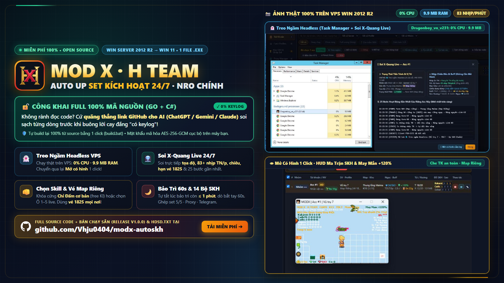

<p align="center">
  
</p>

# MOD X · H TEAM — Auto Up Set Kích Hoạt (NRO Chính)

Công cụ quản lý đa tài khoản & tự động săn **Set Kích Hoạt (SKH)** 24/7 cho **Ngọc Rồng Online (Teamobi)**, phát triển miễn phí & công khai **100% mã nguồn (Go + C#)** bởi **H TEAM**.

> 🔓 **100% FULL MÃ NGUỒN MỞ — NÓI KHÔNG VỚI KEYLOG:**
> Toàn bộ source Go (QLTK) và C# (Client Mod) đều công khai tại repo này, không obfuscate, tự build lại được chỉ bằng 1 click (`build.bat`). **Không rành đọc code? Cứ quăng thẳng link GitHub này cho AI (ChatGPT / Gemini / Claude) soi sạch từng dòng trước khi buông lời cay đắng "có keylog"!**

> 📖 **Xem cẩm nang hướng dẫn chi tiết từng bước từ A → Z:** **[HDSD.md](HDSD.md)** *(hoặc mở file `HDSD.txt` bằng Notepad trong bản ZIP tải về)*

---

## ✨ Điểm nổi bật

- **1 file chạy duy nhất (`ModX_HTeam_AutoSKH.exe`, ~6.4 MB):** Viết bằng **Go 1.20.14** thuần stdlib, **không cần WebView2 / .NET runtime**, chạy mượt từ **Windows Server 2012 R2 (VPS 1 Core / 1–2 GB RAM)** tới **Windows 11**.
- **👻 Treo ngầm không cửa sổ (Unity Headless Mode):** Chạy `-batchmode -nographics -nolog` với **0% GPU**, **~0.2% CPU**, chỉ **~10–25 MB RAM / tab** — gánh thoải mái nhiều acc trên VPS yếu mà vẫn chuyển qua lại **👁 Mở có hình** bất cứ lúc nào.
- **🩻 Soi X-Quang Live (không cần mở cửa sổ game):** Xem trực tiếp map/khu/tọa độ, nhịp ăn tiềm năng/phút, quái đang đánh, chiêu đang dùng, thời hạn TDLT / Cỏ 4 lá / Vé Map Riêng, túi/rương và 25 bước hoạt động gần nhất ngay trên QLTK.
- **👊 Chọn Skill Tàn Sát đồng bộ Live:** Chọn `Chỉ Đấm cơ bản (Dragon/Demon/Galick)`, `Đấm + Kaioken/Liên Hoàn`, `Tự động Đấm+Chưởng`, hoặc `Tự chọn Ô phím 1–5` — lưu phát ăn ngay cả trên tab treo ngầm.
- **🎫 Up Map Riêng (Vé 1825) tối ưu:** Kiểm tra xong dùng vé `[1825]` nhảy thẳng vào map riêng từ bất cứ đâu (không chạy lòng vòng về khu cũ).
- **🌙 Bảo trì thông minh + Dò bắt tay NRO mỗi 60 giây:** Tự bắt thông báo bảo trì trong game, vẫn farm tới mốc **≤ 1 phút** mới tự đóng sạch tab cho VPS nghỉ → tự dò bắt tay giao thức NRO (`cmd -27`) mỗi 60s → bung lại ngay khi máy chủ mở (bắt được cả bảo trì đột xuất vài phút).
- **📅 Lịch chạy nhiều ca tự chọn & Quản lý RAM 3 chốt:** Chia nhiều ca vắt qua nửa đêm, xả RAM nhẹ định kỳ và chỉ restart mềm khi vượt ngưỡng liên tục ≥ 3 phút lúc đang `FARM`.
- **🏆 Kho SKH & Ma trận Ghép Set 5 món (`Áo-Quần-Găng-Giày-Rada`):** Đủ 14 bộ SKH chuẩn NRO mới nhất, lọc giữ từng bộ SKH + đồ `≥ N sao`, tự về nhà cất rương / qua Map 24 bán rác.
- **🔒 Minh bạch & An toàn cục bộ:** Chỉ kết nối `127.0.0.1` (Web UI + Socket NDJSON), máy chủ NRO, proxy bạn nhập và `api.telegram.org` (khi bạn tự cấu hình Bot). Mật khẩu tài khoản mã hóa **AES-256-GCM** ngay trên máy bạn.

---

## ⚡ Chạy nhanh trong 3 bước

1. Tải bản nén sạch `ModX_HTeam_AutoSKH_Public.zip` từ mục **Releases** và giải nén vào 1 thư mục (tránh thư mục hệ thống cần quyền Admin).
2. Mở **`ModX_HTeam_AutoSKH.exe`** → trình duyệt tự mở bảng điều khiển tại `http://127.0.0.1:20269`.
3. Bấm **`＋ Thêm Acc`** → chọn Server & Farm Profile → bấm **`▶ Chạy`** hoặc **`👻 Treo ngầm`**!

> Chi tiết cách cài Proxy, lọc bộ SKH, chọn skill, lịch ca VPS, Telegram và xử lý lỗi: đọc tại **[HDSD.md](HDSD.md)**.

---

## 📂 Cấu trúc dự án

```text
├── main.go, app.go              # Web UI nội bộ (127.0.0.1:20269) + SSE live + System Tray Win32
├── internal/
│   ├── model/                   # Struct Account, FarmProfile, Proxy, Server, Telemetry, LootItem
│   ├── store/                   # Lưu JSON atomic + mã hóa AES-256-GCM + 16 SV NRO & 5 Profile mẫu
│   ├── protocol/                # TCP Socket NDJSON (127.0.0.1:20268), buffer riêng từng tab
│   ├── loot/                    # Ma trận ghép Set 5 món cho 14 bộ SKH & lịch sử rớt đồ
│   ├── proxy/                   # Parser đa định dạng + Check Live/Ping HTTP & SOCKS5 16 luồng
│   ├── launcher/                # Launch Visible/Headless, Trim WorkingSet, Tray, xếp lưới Win32
│   ├── notify/                  # Telegram Bot Alert chống spam
│   └── manager/                 # Watchdog 24/7, khóa chống trùng PID, lịch ca, bảo trì 60s
├── frontend/                    # Web UI Dark Slate (HTML/CSS/JS thuần, embed thẳng vào .exe)
├── client/AssemblyCSharp/       # Source Client Mod C# (.NET 3.5 / Unity 5.6) cho Dragonboy_vn_v231
├── build.bat                    # Chạy Go test + MSBuild Release DLL + go-winres + Build .exe
├── pack_release.bat             # Đóng gói bản phát hành sạch 100% (không kèm data/ & rms)
└── HDSD.md                      # Cẩm nang hướng dẫn sử dụng chi tiết từ A -> Z
```

---

## 🛠️ Build từ Source Code (cho Dev)

**Yêu cầu:**
- **Go 1.20.14** (cài tại `%USERPROFILE%\sdk\go1.20.14\bin\go.exe` để giữ tương thích Windows Server 2012 R2 — PE `6.1`).
- **Visual Studio Build Tools (MSBuild)** có workload `.NET desktop build tools`.
- **`go-winres`** (`go install github.com/tc-hib/go-winres@latest`) để nhúng icon & manifest.
- Copy thư mục `game/` (client gốc `Dragonboy_vn_v231`) đặt cạnh `build.bat`.

**Lệnh build & đóng gói:**
```bat
:: Build toàn bộ (Go test + Assembly-CSharp.dll + ModX_HTeam_AutoSKH.exe)
build.bat

:: Đóng gói bản phát hành sạch (xuất ra release\ModX_HTeam_AutoSKH_Public.zip)
pack_release.bat
```
